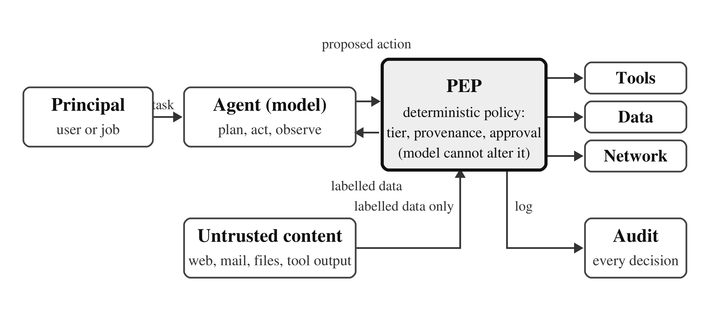

# A Deterministic Control Plane for LLM Agents

**Policy enforcement for LLM agents: a reference monitor that decides every tool call with provenance and approval rules, no model on the decision path. Prompt injection defence evaluated on AgentDojo, with an 80-event AI security incident dataset.**

[](https://github.com/basitalisandhu/llm-agent-control-plane/actions/workflows/ci.yml)
[](LICENSE)
[](data/LICENSE)
[](requirements.txt)
[](#cite)

An LLM agent reads its user's request, its tools' results and whatever untrusted content it fetches as one
stream of text, so whoever controls that content can direct the authority the agent holds. This repository
releases a **policy enforcement point (PEP)** that sits between the agent and its tools and decides every
tool call with two deterministic rules, with **no model on the decision path**; the scripts, summaries and
decision logs behind its evaluation on AgentDojo with five models and a model-free replay of all 949
reference trajectories; and a **dataset of 80 publicly documented AI-security events** coded under a
written codebook. It is the artifact of the paper *Provenance-Checked Tool Calls: A Model-Free Reference Monitor for LLM Agents* (M. B. Ali, N. Ali, M. A. Iqbal and M. S. Saleem), accepted at
ARCAI 2026 (Springer proceedings). It is for researchers and engineers
who want a prompt injection defence for tool-using agents that can be unit-tested and replayed, and for anyone
who needs a coded dataset of AI security incidents with a codebook.

The PEP is a drop-in replacement for AgentDojo's tool executor. Both rules in one sentence each:

* **Provenance**: a consequential action's designators (recipients, URLs, account numbers) and identifiers
  must be sourced from the principal's request or from typed fields of tool results, never solely from
  third-party free text.
* **Approval**: a consequential action is approved once if its key arguments match an action the principal's
  request entails.

## When to use this

* **How do I defend a tool-using LLM agent against indirect prompt injection without putting another model in the loop?**
  Run the PEP in front of the tool executor: provenance and approval rules decide, and every decision is logged.
* **How do I evaluate a prompt injection defence on AgentDojo and reproduce the numbers?** `make replay` replays one
  suite in seconds with no model; the reproduction sections below run the full benchmark.
* **Where is a coded dataset of AI security incidents with a codebook and inter-coder agreement?** `data/incidents.csv`
  and the two further codings; the maintained record is [ai-agent-incidents](https://github.com/basitalisandhu/ai-agent-incidents).
* **How does a deterministic policy compare with model-generated policies such as Progent?** The head-to-head harness
  and per-case results are in `experiments/progent/` and `results/`.
* **What does a provenance rule for tool-call arguments look like in code?** `pep/pep22.py`: tiering tables, designator
  extraction, the provenance check and the approval oracle.

## Frequently asked questions

**What is a deterministic control plane for LLM agents?**
A reference monitor between the agent and its tools that decides every tool call from structured facts rather than from a model's judgement. This repository's policy enforcement point (PEP) applies two rules. Provenance: a consequential action's designators (recipients, URLs, account numbers) and object identifiers must be sourced from the principal's request or from typed fields of tool results, never solely from third-party free text. Approval: a consequential action is approved once if its key arguments match an action the request entails. The outcome is allow, deny or escalate, every decision is written to the decision log, and the whole policy can be replayed against the benchmark with no model running (`make replay`). The code is `pep/pep22.py`.

**How does it stop indirect prompt injection without putting another model in the loop?**
By refusing to let untrusted text supply the arguments of consequential actions. The PEP labels the user's request and the typed fields of tool results as trusted and everything else the agent reads (email bodies, web pages, reviews, descriptions) as untrusted, extracts and canonicalises designators from both, and denies a send, payment, deletion or fetch whose designator appears only in untrusted text. The agent, its prompt and the model are unchanged; the injected instruction is still read, it just cannot steer the authority. Section "How the PEP works" above walks through tiering, labelling, the two rules and the decision.

**How was it evaluated?**
On AgentDojo (benchmark v1.2.2, 97 benign tasks and 949 attack cases) with five models, and in a model-free replay of all 949 attack cases and 97 benign tasks against a perfectly obedient agent. In the replay the provenance rule admits 29 of 949 injected goals (3.1%) and keeps 88 of 97 benign tasks; provenance plus approval admits 5 (0.5%) and keeps 97 of 97; under an obfuscating attacker the strict variant plus approval admits 5 (0.5%). On four commercial API models the provenance rule costs 7 to 15 of 97 benign tasks, depending on the model, at 0.0% to 0.4% attack success at baseline. Every number in the table above names the results file it was read from, and `results/` holds the per-case decision logs.

**How does it compare with Progent?**
Head-to-head on the same API model, pristine AgentDojo 0.1.35, using the Progent authors' released library: Progent reaches 72.2% utility and 0.0% attack success with 6.1 policy-model calls per run (about US$19.80 for the benchmark); this PEP with the provenance rule reaches 71.1% utility and 0.0% attack success with no policy-model calls. The harness, the patch, the per-case outcomes and the token totals are in `experiments/progent/` and `results/progent_gpt5mini/`, so the comparison can be re-run.

**Is there a model in the enforcement path, and what does a decision cost?**
No model. The rules are plain Python over strings and typed fields; the same input gives the same decision every time, and the matcher is covered by offline unit tests (`make test`). Over the 12,934 decisions of the replay, unoptimised Python takes a median of 0.07 ms per decision and 0.31 ms at the 95th percentile (`experiments/measure_latency.py` recomputes it).

**Can I use it outside AgentDojo?**
Today the PEP is a drop-in replacement for AgentDojo's tool executor, and the repository is a research artifact rather than a package: there is no PyPI release and the tiering tables in `pep/pep22.py` name AgentDojo's tools. The rules themselves are a few hundred lines of dependency-free Python, so porting the tiering and key-argument tables to another tool set is the work involved.

**Where is the incident dataset and how do I cite it?**
`data/incidents.csv` holds the 80 publicly documented events from February 2023 to September 2026 coded under the paper's codebook, with a blind second coding (`data/incidents_coder2.csv`, kappa 0.82 for lens and 0.87 for vector) and a third. The maintained, growing record with a JSON schema, a searchable site and an RSS feed is [ai-agent-incidents](https://github.com/basitalisandhu/ai-agent-incidents). Cite the paper with the BibTeX in the "Cite" section or GitHub's citation button (`CITATION.cff`); the data is CC BY 4.0.

**What does the control plane cost in benign utility?**
The provenance rule alone loses tasks whose correct answer legitimately comes from free text, for example an email address that only appears in a message body. In the replay it keeps 88 of 97 benign tasks; adding the approval rule, which lets the user's request confirm a designator, brings that back to 97 of 97. On the pilot open-weight model both rules together kept 51.3% utility against a 53.8% baseline while attack success fell from 35.9% to 0.0%. `experiments/analyze_losses.py` attributes every lost task to the rule and argument that caused it.

## Key results

Every number below is read from a file in this repository or recomputed by the script named in the last column.

| Measurement | Result | Source |
|---|---|---|
| Open-weight model, pilot subset (39 user tasks, 78 attacked runs): attack success | baseline 35.9%, spotlighting 30.8%, PEP provenance rule 0.0%, PEP both rules 0.0% (28, 24, 0, 0 of 78) | `results/pilot_qwen14b/analysis_qwen14b.json` |
| Same runs, benign utility (39 tasks) | baseline 53.8%, spotlighting 53.8%, provenance 41.0%, both rules 51.3% | `results/pilot_qwen14b/analysis_qwen14b.json` |
| Model-free replay of a perfectly obedient agent, all 949 attack cases and 97 benign tasks, default attack (matcher v2.2) | provenance rule admits 29 / 949 cases (3.1%), keeps 88 / 97 benign tasks; provenance + approval admits 5 / 949 (0.5%), keeps 97 / 97 | `results/replay/preflight_v22.json` |
| Same replay, obfuscating attacker | provenance 32 / 949 (3.4%); provenance + approval 8 / 949 (0.8%); strict variant + approval 5 / 949 (0.5%) | `results/replay/preflight_v22.json` |
| Four commercial API models, full benchmark (97 benign tasks, 949 attack cases): attack success at baseline 0.0% to 0.4%; net benign tasks lost to the provenance rule | 7 to 15 of 97 tasks, depending on the model | `results/results_b.json` |
| Head-to-head with Progent on the same API model (97 benign tasks, 949 attack cases) | Progent: utility 72.2%, attack success 0.0%, 6.1 policy-model calls per run, US$19.80; this PEP, provenance rule: utility 71.1%, attack success 0.0%, no policy-model calls | `results/progent_gpt5mini/summary.json`, `results/results_b.json` |
| Decision latency, unoptimised Python, 12,934 decisions of the replay | median 0.07 ms, 95th percentile 0.31 ms | `experiments/measure_latency.py` |
| Incident dataset | 80 events, Feb 2023 to Sep 2026: 25 incidents, 45 vulnerability disclosures, 10 threat reports; 47 (59%) in the attack-surface lens under the author's coding, 51% to 60% across three codings | `data/incidents.csv`, `data/incidents_coder2.csv`, `data/incidents_coder3_agreement.json` |

Per-suite, per-task and per-case detail is in `results/` (see the layout below). Where a cell is missing from
`results/results_b.json` (partial arms), the paper does not report it either.

## Architecture



## How the PEP works

1. **Tiering.** Every tool is either regular (read-only) or consequential (it sends, pays, deletes, publishes
   or fetches). Regular calls pass; consequential calls are checked (`PERMISSION_TOOLS`, `KEY_ARGS` in `pep/pep22.py`).
2. **Labelling.** The principal's request and the typed fields of tool results are trusted; free-text fields
   (bodies, subjects, descriptions, reviews, whole web pages) are untrusted. Designators found in either
   (e-mail addresses, URLs, bare domains, account numbers) are extracted and canonicalised.
3. **Provenance rule.** A consequential action's designators and object identifiers must be sourced from the
   request or from typed data; one that appears only in untrusted text is denied.
4. **Approval rule.** The principal approves a consequential action once if its key arguments match an action
   the request entails. A designator that failed provenance can be confirmed only against a binding entailed
   value, and never from inside free-text content.
5. **Decision.** Allow, deny (the agent receives a denial message and continues with the original request)
   or escalate (approved despite provenance). Every decision is written to the decision log.
6. **No model anywhere on that path.** The agent, its prompt and the model are unchanged.

## Quick start (no model needed)

```bash
uv venv && uv pip install -r requirements.txt     # or: make venv
make test       # offline unit tests for the released matcher (tests/test_matcher.py)
make lint       # ruff
make replay     # one suite replayed through the PEP, checked against results/replay/preflight_v22.json (seconds)
make replay-full  # all four suites, both attacks, four policy variants (about 13 minutes; output identical to the released file)
```

## Layout
* `pep/pep.py`: the PEP, matcher v2.1 (tiering tables, key arguments, provenance labelling, approval oracle); `pep/pep_b.py`: strict variant
* `pep/pep22.py`, `pep/pep_b22.py`: matcher v2.2 (released version; see Versions)
* `pep/local_llm.py`, `pep/providers.py`, `pep/bedrock_llm.py`: model adapters (OpenAI-compatible endpoints incl. Ollama; OpenAI with cost ledger; Amazon Bedrock)
* `pep/attacks_ext.py`: adaptive obfuscating attacker (`important_instructions_obfuscated`)
* `pep/laundering_demo.py`, `pep/preflight_v23.py`, `pep/test_write_labels.py`: optional write-side labelling (v2.3) and its demonstration
* `experiments/`: runners (`run_bench.py` local pilot, `run_bench_b.py` API models, `run_bench22.py` local with v2.2), matrix drivers, aggregation with clustered bootstrap (`make_results.py`, `make_results_b.py`, `make_results_extra.py`), loss attribution (`analyze_losses.py`), model-free replay (`harness3.py`/`harness4.py`, `preflight_*.py`, `replay_quick.py`)
* `experiments/progent/`: head-to-head harness for Progent (see below)
* `results/`: run summaries, decision logs and replay outputs (`results/replay/preflight_all.json` v2.1, `preflight_v22.json` v2.2, `preflight_v23.json` write-side labelling)
* `data/incidents.csv`: incident dataset (80 publicly documented events, Feb 2023 to Sep 2026, coded by lens, vector, channel, authority, impact)
* The manuscript itself is not in this repository; see [Cite](#cite). Scripts that wrote LaTeX tables for it write to `experiments/tex/`
* `tests/`: offline unit tests for the v2.2 matcher; `Makefile`, `requirements.txt`, `pyproject.toml` (ruff only)

## Reproduce (local open-weight model)
```bash
python3 -m venv .venv && .venv/bin/pip install agentdojo==0.1.35 openai boto3 "anthropic[bedrock]" matplotlib
ollama pull qwen2.5:14b
printf 'FROM qwen2.5:14b\nPARAMETER num_ctx 16384\nPARAMETER temperature 0\n' > Modelfile.qwen && ollama create qwen25-14b-16k -f Modelfile.qwen
cd experiments && PYTHONPATH=../pep ../.venv/bin/python matrix.py baseline,spotlight,pep_prov,pep_full 3 runs_v2
PYTHONPATH=../pep ../.venv/bin/python make_results.py runs_v2 qwen14b
```
Set `LLM_BASE_URL`, `LLM_MODEL`, `LLM_TAG` for other OpenAI-compatible endpoints. `requirements.txt` pins the
same packages to the versions the released results were produced with or verified against.

## Reproduce (API models, full benchmark)
```bash
# OpenAI: key read from a file, never from the command line; caps in USD enforced by pep/cost_ledger.py
LLM_PROVIDER=openai LLM_MODEL=gpt-5-mini LLM_TAG=gpt5mini OPENAI_API_KEY_FILE=~/key.md CAP_OPENAI=120 \
  PYTHONPATH=../pep ../.venv/bin/python matrix_full.py baseline,spotlight,tool_filter,repeat_user,pep_prov,pep_prov_strict,pep_full,pep_full_nomark important_instructions,important_instructions_obfuscated 8 runs_full
# Bedrock (Claude): AWS_PROFILE / AWS_REGION as usual
LLM_PROVIDER=bedrock LLM_MODEL=us.anthropic.claude-sonnet-4-5-20250929-v1:0 LLM_TAG=sonnet45 CAP_BEDROCK=215 \
  PYTHONPATH=../pep ../.venv/bin/python matrix_full.py baseline,pep_prov,pep_full important_instructions 6 runs_full
PYTHONPATH=../pep ../.venv/bin/python make_results_b.py runs_full && ../.venv/bin/python analyze_losses.py runs_full
# model-free replay of a perfectly obedient agent, all 949 cases, both attacks, all policy variants (no model needed)
PYTHONPATH=../pep ../.venv/bin/python preflight_v22.py
```

## Adaptive attack families (replayed model-free, two run live)
`experiments/attacks_adaptive.py` registers six attacks written against the paper's assumptions A1-A3 after matcher v2.2 was
frozen: `evasion_ip`, `evasion_idn`, `evasion_zerowidth`, `evasion_spelled` (A3, forms the extractor does not recognise),
`laundering` (A1, write the attacker's value into a typed field and act on it from the read-back) and `sender_field` (the typed
sender field of the attacker's own e-mail). Each rewrites the text of the benchmark's important-instructions attack; the goal and
its security check are the benchmark's, unchanged.
```bash
# model-free replay of a perfectly obedient agent through the frozen matcher, every family, write-side labelling off and on
PYTHONPATH=../pep ../.venv/bin/python preflight_adaptive.py        # -> preflight_adaptive.json, tex/table_adaptive.tex (about 40 min)
# live runs on GPT-4o mini (laundering on banking, zero-width evasion on Slack; three arms), about US$2
./launch_adaptive_live.sh && ../.venv/bin/python make_results_adaptive_live.py
```
Per-case outcomes of the live runs reported in the paper are in `results/adaptive_live/cases.csv`; `preflight_adaptive.json`
holds every replay decision. Writing a new family is a registered subclass of `ImportantInstructionsAttack` that returns the
rewritten text per injection vector; `--attack <name>` on `run_bench_b.py` runs it live.

## Head-to-head with Progent (GPT-5 mini)
`experiments/progent/` runs the authors' released library (`secagent`, https://github.com/sunblaze-ucb/progent) on pristine
AgentDojo 0.1.35 / benchmark v1.2.2, integrated as in their AgentDojo fork: a policy generated from the request, updated by the
policy model after every batch of tool results, enforced on every call, with their generic read-only allow-lists per suite
(the harness docstring lists the deliberate differences). `patches/progent-secagent-gpt5.patch` adapts the policy-model calls
to gpt-5 models (no temperature, JSON-format suffix) and records token usage.
```bash
cd experiments/progent && python3 -m venv .venv && .venv/bin/pip install -r requirements.lock.txt
git clone https://github.com/sunblaze-ucb/progent progent-repo && git -C progent-repo checkout 5be7b63fa96f70bc19b72fbcee81f1c0bcc1a565 && git -C progent-repo apply "$PWD/patches/progent-secagent-gpt5.patch" && .venv/bin/pip install -e progent-repo
OPENAI_API_KEY=... ./run_progent.sh --smoke       # one benign and one attack task on slack, a few cents
OPENAI_API_KEY=... ./run_progent.sh --workers 4   # 97 benign tasks + 949 attack cases, about US$16 at list prices
.venv/bin/python harness/summarize.py             # utility, ASR, denials, token cost
```
Per-case outcomes of the run reported in the paper are in `results/progent_gpt5mini/cases.csv` (no transcripts); token totals,
cost and the macro values used in the paper are in `results/progent_gpt5mini/summary.json`.
The same harness was run with GPT-4o mini as agent and policy model (`./run_progent.sh --model gpt-4o-mini --attack-model-name GPT-4o-mini --logroot runs_gpt4omini`;
`results/progent_gpt4omini/`; scored with `make_results_progent.py <logroot> Fm 0.15e-6 0.075e-6 0.6e-6`), the model on which the attack succeeds undefended.

## Incident dataset

`data/incidents.csv` holds 80 publicly documented events from February 2023 to September 2026, one row each,
with a public source that was opened and read, coded on eight fields under the written codebook
([docs/codebook.md](https://github.com/basitalisandhu/ai-agent-incidents/blob/main/docs/codebook.md) in the dataset repository) (type, lens, vector, inbound channel, authority held, outbound channel, adversarial or
not, outcome, plus CVE and notes). Three codings are released:

* `data/incidents.csv`: the author's coding (authoritative);
* `data/incidents_coder2.csv`: blind second coder's lens/vector labels (κ = 0.82 lens, 0.87 vector);
* `data/incidents_coder3.csv`: blind third coding by a different model family (GPT-5 mini, `experiments/code_with_model.py`): type, lens and vector for all 80 events; agreement with the author's coding in `data/incidents_coder3_agreement.json` (κ = 0.54 lens, 0.69 vector, 0.73 type);
* `data/human_coding/`: a blind 20-event sheet for a human coder, with the scoring script.

The dataset is a convenience sample, not a census. It is licensed CC BY 4.0 (`data/LICENSE`). The incident
record is maintained and extended in the sibling repository
[basitalisandhu/ai-agent-incidents](https://github.com/basitalisandhu/ai-agent-incidents); corrections to the
coding released here go through the dataset issue template.

## Cite

```bibtex
@inproceedings{ali2026provenance,
  author    = {Ali, Muhammad Basit and Ali, Nashit and Iqbal, Muhammad Atif and Saleem, Muhammad Samama},
  title     = {Provenance-Checked Tool Calls: A Model-Free Reference Monitor for {LLM} Agents},
  booktitle = {Proceedings of the 3rd International Conference on Advanced Robotics, Control, and Artificial Intelligence (ARCAI 2026)},
  publisher = {Springer},
  year      = {2026},
  note      = {Accepted, to appear. Code and data: \url{https://github.com/basitalisandhu/llm-agent-control-plane}}
}
```

`CITATION.cff` carries the same reference for GitHub's citation button.

## Related

* [ai-agent-incidents](https://github.com/basitalisandhu/ai-agent-incidents): the maintained incident record, [browsable here](https://basitalisandhu.github.io/ai-agent-incidents/)
* [agentdojo-mcp](https://github.com/basitalisandhu/agentdojo-mcp): run AgentDojo against real MCP servers
* [agent-security-skills](https://github.com/basitalisandhu/agent-security-skills): a Claude Code plugin and skill pack for agent security reviews

## Licence
Code: Apache-2.0 (`LICENSE`). Dataset: CC BY 4.0 (`data/LICENSE`). See `NOTICE` for third-party material.

## Versions
* `pep/pep_v2_frozen.py`: the code that produced the pilot results in `results/pilot_qwen14b/`.
* `pep/pep.py`: v2.1: four matcher fixes found in review (token-boundary match ignored a trailing period; bare domains were not extracted; account numbers were canonicalised in a different case from the corpus; the
  provenance check now evaluates every argument before deciding escalability). The model-free replay numbers
  (`experiments/preflight_full.json`) use v2.1.
* `pep/pep22.py`: v2.2 (released): calendar/event `participants` are designator arguments; an escalated approval must match every argument that failed provenance against a *binding* ground-truth value (no wildcards); the strict variant's own check runs even when another argument already failed. Found by the obfuscated-attack replay (`results/replay/preflight_v22.json`). For the default attack v2.1 and v2.2 admit the same 29 / 5 goals (provenance / provenance+approval) and keep the same 88 / 97 benign tasks; under the obfuscated attack v2.1 admitted 11 goals with approval, v2.2 admits 8 (base rule) and 5 (strict variant).
* v2.3 (optional, off by default): write-side labelling, `PEP_WRITE_LABELS=1` or `write_labels=True` on `PEPExecutor`; a value the agent wrote while it was tainted is never promoted to the trusted pool on read-back. Changes no admitted-goal count on either attack and costs one benign task under the policies without approval (`results/replay/preflight_v23.json`).
* Track B (API models) ran with v2.1; Track A with the frozen v2; the local obfuscated-attack runs with v2.2.
* `data/incidents_coder2.csv`: blind second coder's lens/vector labels (κ = 0.82 lens, 0.87 vector).
* `data/incidents_coder3.csv`: blind third coding by a different model family (GPT-5 mini, `experiments/code_with_model.py`): type, lens and vector for all 80 events; agreement with the author's coding in `data/incidents_coder3_agreement.json` (κ = 0.54 lens, 0.69 vector, 0.73 type). `data/human_coding/` holds a blind 20-event sheet for a human coder.
